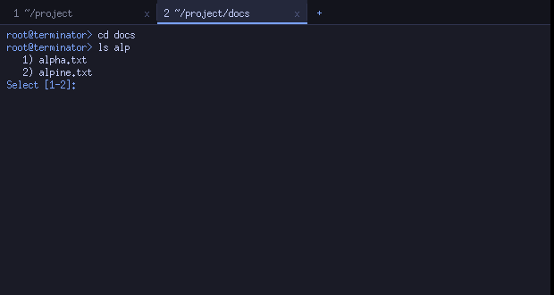
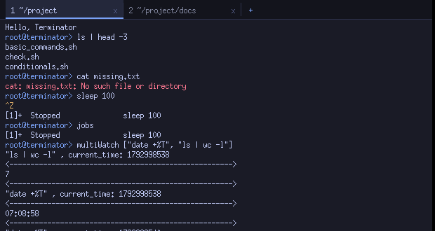

# Terminator — a custom terminal emulator and shell

CS69201 Computing Lab, IIT Kharagpur. Terminator is a terminal emulator (Xlib/X11, multiple tabs) **and** a
shell (lexer, parser, expansion, pipelines, redirection, job control, scripts), written in C for Linux.
It does not use `/bin/bash`, `/bin/sh`, `system()` or `popen()` for anything: commands, pipelines,
substitutions and scripts are interpreted by this program; only the *programs you run* (`ls`, `gcc`, …)
are separate processes.




## Build

Ubuntu (also inside an Ubuntu VirtualBox VM on a Mac — needs a graphical X11 session):

```
sudo ./scripts/setup_ubuntu.sh        # build-essential pkg-config libx11-dev (+ optional GUI test tools)
make                                  # produces ./terminator
make debug                            # AddressSanitizer + UBSan build -> ./terminator-debug
make test                             # unit + integration (+ GUI suite if Xvfb/xdotool are installed)
make clean
```

Required packages: `gcc`, `make`, `pkg-config`, `libx11-dev`. Nothing else is linked (`-lX11 -lpthread`).

## Run

```
./terminator                    # thread mode (default): one shell-engine thread per tab
./terminator useProcess=True    # process mode: one forked shell process per tab
./terminator --headless         # no GUI: commands from stdin (used by the automated tests)
./terminator --cwd DIR          # start directory of the first tab
```

Both modes use the same shell engine and behave identically (the integration tests run every scenario in both).

### Using it

* **Tabs**: `+` button or `Ctrl+Shift+T`; click a tab to switch, click its `x` (or middle-click) or `Ctrl+Shift+W` to close;
  `Alt+1…9`, `Ctrl+PageUp/PageDown` switch. A new tab starts in the current tab's directory; every tab has its own
  directory, job table, input line and scrollback. `exit` / `Ctrl+D` on an empty line closes the tab.
* **Scrolling**: mouse wheel or `Shift+PageUp/PageDown`. **Selection**: drag with the mouse (becomes the PRIMARY
  selection, middle-click pastes), `Ctrl+Shift+C` copies to the CLIPBOARD, `Ctrl+Shift+V` pastes.
* **Prompt** `user@terminator>`; `>` is the continuation prompt for incomplete commands.

| Key | Action | Key | Action |
|---|---|---|---|
| Left / Right | move cursor | Ctrl+U / Ctrl+K | delete to line start / end |
| Ctrl+A / Ctrl+E (Home/End) | line start / end | Ctrl+W | delete previous word |
| Up / Down | browse shared history | Ctrl+L | clear screen |
| Ctrl+R | search history | Tab | complete filename |
| Ctrl+C | interrupt foreground job | Ctrl+Z | suspend foreground job |
| Ctrl+D | EOF to program / close tab at empty prompt | Ctrl+Shift+C / V | copy / paste |

Key bindings are configurable without recompiling: `bind` lists them, `bind <action> <Key>` changes one and saves it in
`~/.terminatorrc` (`TERMINATOR_RC` overrides the path), e.g. `bind line_start Ctrl+B`. The file format is
`bind <action> = <Mod+Mod+Key>` with `#` comments. Invalid entries, unknown actions and conflicting bindings are
reported as warnings in the tab and the safe default stays in force.

### Shell features

External commands (`fork`/`execvp`), builtins `cd exit history multiWatch jobs fg bg source .` plus `export unset echo pwd
clear bind test [ true false :`; quoting (`'…'`, `"…"`, `\`), line continuation, multi-line quotes, `$VAR ${VAR} $? $# $1…$9 $$`,
`$(…)` and backticks (nested), `~`, wildcards `* ? […]`, `<`, `>`, `>>`, pipelines of any length, `;`, `&&`, `||`, `&`;
job control (`jobs`, `fg %n`, `bg %n`, Ctrl+C/Ctrl+Z delivered to the job's process group); `multiWatch ["cmd1", "cmd2"]`;
scripts via `./script.sh`, `bash script.sh`, `source script.sh` with `if/elif/else/fi`, `[ … ]`/`test`, `exit [n]`.

## Requirement status

Legend: **Done** = implemented and covered by an automated test that passes; see `docs/testing.md` for how each is tested.

| Spec section | Status | Notes / evidence |
|---|---|---|
| 3 Thread mode / process mode | Done | `src/concurrency/`; all suites run in both modes; GUI test covers crash isolation in process mode |
| 4 Xlib GUI (tabs, scrollback, resize, mouse, clipboard, close) | Done | `src/gui/`; `tests/gui/gui_test.sh` (Xvfb, real key/mouse events) + screenshots |
| 4 GUI never freezes / no busy-wait | Done | single `poll()` over X connection + tab pipes; GUI test runs a 4 s command while using another tab and resizing |
| 5 Basic commands, `$?`, errors | Done | `test_commands.sh` |
| 5 Builtins cd exit history multiWatch jobs fg bg source | Done | `src/shell/builtins.c`; state-changing ones run inside the tab's engine |
| 6 Parser: quotes, escapes, continuation, `$()`/backticks nested, `$?` `$1-9` `$#`, syntax errors, `>` prompt | Done | `test_lexer`, `test_parser`, `test_expansion`, `test_multiline.sh` |
| 7 Redirection (`<`, `>`, both, errors, no exec after failed input) | Done | `test_redirection.sh` |
| 8 Pipelines, N−1 pipes, process groups, wildcards, `xargs` example | Done | `test_pipelines.sh` |
| 9 multiWatch (concurrent, poll, label/timestamp/separator, 2 s rerun, Ctrl+C cleanup) | Done* | `test_features.sh`, GUI test. *Output format reconstructed — see Known limitations |
| 10 Editing shortcuts + persistent, validated key bindings | Done | `test_config`, `test_features.sh`, GUI test |
| 11 Signals, `&`, jobs/fg/bg, process-group delivery | Done | `test_job_control.sh`, GUI test |
| 12 Shared history, 10 000 persisted, 1 000 shown, Ctrl+R algorithm | Done* | `test_history` (4 threads, 4 processes), `test_features.sh`, GUI test. *File name — see below |
| 13 Filename completion (one / many / list+select / none) | Done | `test_completion`, GUI test |
| 14 Script interpreter, `source`, validation | Done | `test_scripts.sh` |
| 17 Syscall correctness, no leaks/zombies | Done | all suites pass under ASan+UBSan with leak detection; zombie/orphan checks in tests |
| 18 Makefile (`make`, `clean`, `test`, `debug`) | Done | pkg-config flags, `-Wall -Wextra`, builds warning-free |
| Loops, functions (not required) | Not implemented | reported as an explicit error |

## Known limitations and decisions (please read)

* **The assignment PDF and lecture slides were not available to me — only the project prompt text.** Where it defers to
  them I chose the most common reading and kept it in one place:
  * *multiWatch format*: each chunk of output is printed as `"cmd" , current_time: <unix-seconds>`, a separator line
    (`MW_SEPARATOR` in `include/multiwatch.h`), the output, and the separator again. Change that header/constant if your
    spec differs. Each watched string must be a single pipeline.
  * *History file*: `~/.terminator_history` (plain text, one command per line; override with `TERMINATOR_HISTFILE`).
    A multi-line command is stored on one line (newlines → spaces).
  * *Ctrl+R*: prompt `Enter search term:`; exact most-recent match → put on the input line; else longest common substring
    (> 2 chars) → one hit goes to the input line, several hits are listed and selected by number; else
    `No match for search term in history`. The chosen command is placed on the input line (not run automatically).
* **No pseudo-terminal.** Programs get pipes, so there is no line editing by the tty, programs may block-buffer stdout
  (a `printf` prompt without newline appears late), and full-screen programs (`vim`, `top`) do not work. ANSI escapes are
  stripped, not rendered. Typed text reaches a running program line by line (on Enter); `Ctrl+D` closes its stdin.
* Text is shown with an X core font; bytes ≥ 0x80 (UTF-8) are drawn as `?`. If no large font is installed the built-in
  6×13 `fixed` font is used (install `xfonts-base` for a bigger one).
* Only `<`, `>`, `>>` redirections: no `2>`, `2>&1`, here-documents, `$((…))`, loops, `case`, functions, aliases.
* `cd` uses logical paths (no symlink resolution); `~user` is not supported.
* `exit` inside a `source`d script or `$(…)` ends only that script/substitution (not the tab). Ctrl+Z is ignored while a
  script or substitution is running. A background job later brought to the foreground with `fg` has no stdin.
* `./script.sh` is interpreted internally only when it starts with a `bash`/`sh`/`dash` shebang (or has none); scripts found
  through `PATH` and non-shell shebangs are run by the kernel as usual.
* Thread mode: a hard crash inside an engine thread takes down the whole program (inherent to threads); process mode
  isolates it — that is the point of having both.
* Tested on Ubuntu 24.04 (gcc 13) with Xvfb and no window manager. It has **not** been run on a VirtualBox VM or with a real
  window manager/compositor; only Xlib features that any X server supports are used.

## Layout

See `DESIGN.md` (architecture, protocol, design decisions), `docs/architecture.md` (module map) and `docs/testing.md`
(tests and manual GUI checklist). `scripts/demo.sh` prints a demo plan; `scripts/screenshots.sh` regenerates screenshots.
